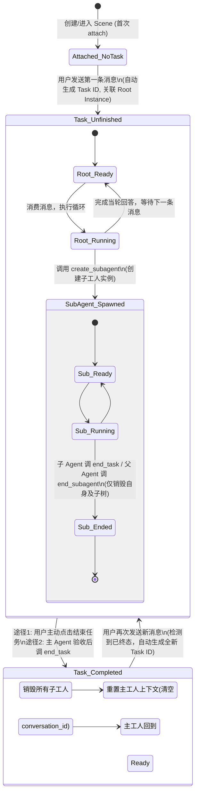
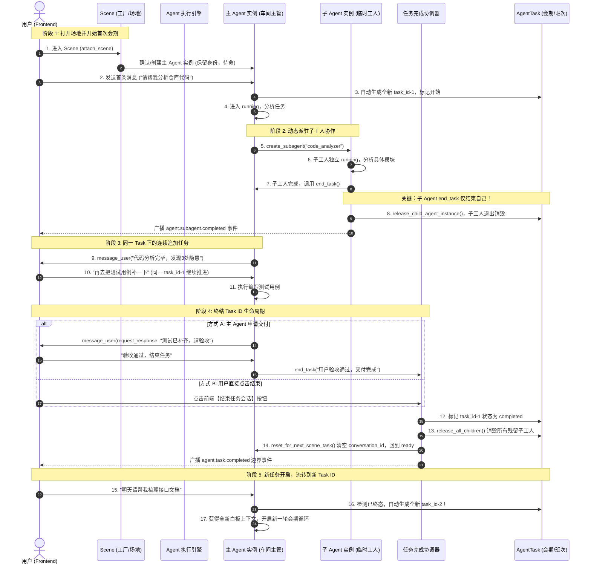

# Scene、Agent 定义、Agent 实例与 Task ID 生命周期架构设计说明

## 1. 概述与核心设计思想

### 1.1 背景与解决的工程痛点

在构建长周期、复杂多 Agent 协同的桌面与服务端 AI 系统中，传统将“单个用户提问-回答”或“单个原子操作（如炒菜、写作业）”简单定义为“一个任务”的模型面临三大核心工程痛点：

1. **大模型上下文窗口（Context Window）的无序膨胀与污染**：
   如果任务与会话永不终结，随着多轮工具调用、文件读写、子 Agent 汇报的累积，Token 消耗呈爆炸式增长，注意力机制被严重稀释，模型产生幻觉与偏离主线的概率大幅上升。
2. **多 Agent 协同下的“幽灵实例”挂起与资源泄漏**：
   解决复杂任务时需要临时动态派遣专业子 Agent，若缺乏明确的生命周期边界，任务结束后子 Agent 极易变成孤儿进程或悬挂实例，持续占用内存、进程、终端与网络句柄。
3. **用户心智认知与底层执行模型的脱节**：
   在真实工作场景中，用户习惯在一个固定的工作界面中连续安排一系列渐进式工作（例如：“先分析代码”、“再编写测试”、“最后补全文档”）。系统既需要为用户保持界面历史的连贯性，又必须在底层提供物理级别隔离的执行边界。

### 1.2 核心隐喻：工厂、工种、工人与工作会期

为清晰界定静态与动态、空间与时间、主体与周期的边界，系统确立了四个层级的核心抽象模型：

```text
+-----------------------------------------------------------------------------------+
| Scene (场地 / 工厂车间)                                                             |
| 永久存在的工作空间容器，绑定固定主工种，前端 1:1 Tab 映射，承载通信流与气泡历史             |
|                                                                                   |
|  +-----------------------------------------------------------------------------+  |
|  | Task ID (工作会期 / 生产班次)                                                 |  |
|  | 一次连续协同活动的生命周期边界，圈定上下文窗口、子工人树存续与清理终态             |  |
|  |                                                                             |  |
|  |    +------------------------+        +------------------------+             |  |
|  |    | 主 Agent 实例 (车间主管) | <----> | 子 Agent 实例 (临时工人) |             |  |
|  |    | 遵循主 Agent 定义        |        | 遵循子 Agent 定义        |             |  |
|  |    | 跨 Task 长期复用身份     |        | 随 Task 或父级释放而消亡 |             |  |
|  |    +------------------------+        +------------------------+             |  |
|  +-----------------------------------------------------------------------------+  |
+-----------------------------------------------------------------------------------+
```

- **Scene（场景 / 场地）$\rightarrow$ 工厂 / 专属车间**：
  物理和逻辑上的工作场地。负责管理与前端的长期通信流（`stream-scene-{scene_id}`）、界面气泡历史（Chat Bubbles）以及多端连接状态（Presence）。
- **Agent 定义（AgentDefinition）$\rightarrow$ 工种定义 / 岗位作业指导书 (SOP)**：
  纯静态的能力模板资产。定义了该工种的系统提示词（Prompt）、可用本地工具（Local Tools）、MCP 外部工具、Skill 技能包以及该工种允许调度的下级子工种白名单。
- **Agent 实例（AgentInstance）$\rightarrow$ 具体的工人**：
  拥有独立工号（`instance_id`）、独立对话上下文（`conversation_id`）、独立待处理队列（`pending_user_messages`）和运行状态（`ready` / `running`）的动态执行实体。
- **Task ID（任务会期标识）$\rightarrow$ 工作会期 / 生产班次（Work Session / Episode Run ID）**：
  不是单次原子指令，而是由用户显式启动、显式终结的**一次端到端协同工作会期**。它界定了 LLM 上下文重置边界、子工人树生存期与审计归档边界。

---

## 2. 核心概念与聚合根设计

### 2.1 Scene（场景聚合根）

源码位置：[`src/agent_runtime/scene/scene.py`](file:///g:/project/agent/agentruntime/src/agent_runtime/scene/scene.py)

```python
@dataclass(frozen=True, slots=True)
class Scene:
    scene_id: str
    project_id: str
    name: str
    description: str
    status: SceneStatus  # "active" | "archived"
    bound_agent_definition_id: str  # 永久绑定的主 Agent 定义 ID，不可变更
    created_at: datetime
    last_active_at: datetime
    metadata: dict[str, Any]
```

#### 关键业务规则与约束：
1. **主工种强绑定不可变**：
   `bound_agent_definition_id` 在 Scene 创建时确定，模型上**禁止修改**。Scene 的主工人始终基于此工种模板运行；变更主 Agent 工种等价于新建工厂（新建 Scene）。
2. **通信与前端映射**：
   前端一个主 Tab 对应一个 `Scene`。通信流 ID 固定为 `stream-scene-{scene_id}`。页面刷新或重连后，前端通过该流和气泡仓储即可无损恢复整个工作流的展示历史。
3. **多端 Presence 隔离**：
   [`SceneSessionRegistry`](file:///g:/project/agent/agentruntime/src/agent_runtime/scene/scene_session_registry.py) 仅维护不同前端设备（移动端、浏览器 Tab、桌面窗口）的在线与心跳状态。前端窗口关闭或页面卸载只退出当前 client session，绝不触发任务中断或 Agent 销毁。

---

### 2.2 Agent 定义（AgentDefinition 聚合根）

源码位置：[`src/agent_runtime/agent_definition/agent_definition.py`](file:///g:/project/agent/agentruntime/src/agent_runtime/agent_definition/agent_definition.py)

```python
@dataclass(frozen=True, slots=True)
class AgentDefinition:
    agent_id: str
    name: str | None
    description: str | None
    system_prompt: tuple[SystemPromptSegment, ...]
    tool_ids: tuple[str, ...]
    mcp_tools: tuple[McpToolBinding, ...]
    skill_ids: tuple[str, ...]
    available_sub_agent_ids: tuple[str, ...]  # 允许调度的子 Agent 定义 ID
    default_llm_policy_group_id: str | None
    allowed_llm_policy_group_ids: tuple[str, ...]
    builtin_background_agent: bool
    disabled: bool
```

#### 关键业务规则与约束：
1. **静态无状态资产**：
   纯配置数据，存放在 `~/.spread-ai/agents/{agent_id}.yaml` 或云端 PostgreSQL 中，不包含任何执行上下文、会话历史或临时状态。
2. **严禁自引用**：
   `available_sub_agent_ids` 绝不能包含自身（`agent_id`），防止子 Agent 递归自我派生引发死循环。
3. **能力白名单控制**：
   Agent 实例在运行时调用 [`create_subagent`](file:///g:/project/agent/agentruntime/src/agent_runtime/subagent/subagent_tool.py) 工具时，入参 `agent_definition_id` 必须在此白名单内，否则系统拒绝创建。

---

### 2.3 Agent 实例（AgentInstance 领域模型）

源码位置：[`src/agent_runtime/agent/agent_instance.py`](file:///g:/project/agent/agentruntime/src/agent_runtime/agent/agent_instance.py)

```python
@dataclass(frozen=True, slots=True)
class AgentInstance:
    instance_id: str
    task_id: str  # 当前绑定的 Task ID
    thread_id: str
    current_working_directory: str
    agent_definition_id: str  # 引用静态 AgentDefinition
    llm_provider_id: str
    llm_model_binding_id: str
    conversation_id: str | None  # 当前会话的上下文 ID，Task 结束后清空
    trace_id: str
    status: AgentInstanceStatus  # 仅两态: "ready" | "running"
    pending_user_messages: tuple[PendingAgentUserMessage, ...]
```

#### 关键业务规则与约束：
1. **极简两态模型（Ready / Running）**：
   实例不再承载 `completed`、`failed`、`paused` 等终态；终态只属于 `AgentTask`。`ready` 表示该工人当前可接收输入，`running` 表示其执行循环正在推进。
2. **主工人（Root Agent Instance）长期常驻**：
   每个 Scene 拥有且仅拥有一个长期的 Root Agent 实例。无论经历多少轮 Task，Root Agent 的 `instance_id`、工种绑定与工作目录始终保持不变。
3. **子工人（Child Agent Instance）从属性**：
   由父 Agent 通过工具派驻，生命周期严格限制在当前 Task 范围内。随父级释放或 Task 终结而被物理销毁。
4. **独立消息队列消费**：
   每个工人拥有独立的 `pending_user_messages` 队列，所有输入按 FIFO 顺序只在完整的执行轮次边界安全消费。

---

### 2.4 Task ID 与任务聚合根（AgentTask 聚合根）

源码位置：[`src/agent_runtime/agent/agent_task.py`](file:///g:/project/agent/agentruntime/src/agent_runtime/agent/agent_task.py)

```python
@dataclass(frozen=True, slots=True)
class AgentTask:
    task_id: str
    root_agent_instance_id: str
    agent_instance_ids: tuple[str, ...]
    parent_child_relations: tuple[AgentParentChildRelation, ...]
    status: AgentTaskStatus  # "unfinished" | "completed" | "failed"
    scene_id: str | None
    started_at: datetime | None
    finished_at: datetime | None
    failed_at: datetime | None
    failure_message: str | None
```

#### 关键业务规则与约束：
1. **会期语义（Episode Run）而不是单指令语义**：
   用户在同一次会话活动中，可以连续发出多个不同领域的任务（例如：“先炒个菜” $\rightarrow$ “再写作业” $\rightarrow$ “最后查天气”）。只要未显式结束任务，这一系列交互都在同一个 `task_id` 和同一个 `conversation_id` 上下文中延续推进。
2. **运行时单根父子关系树**：
   通过 `AgentParentChildRelation` 严格维护一棵以 `root_agent_instance_id` 为唯一根节点的单根有向无环树（Tree Topology）。每个子工人都有且仅有一个直接父工人。
3. **状态三态收敛**：
   Task 状态仅有 `unfinished`（未结束）、`completed`（成功终态）、`failed`（失败终态）。启动、暂停等执行细节不改变 Task 主状态。

---

## 3. 详细生命周期流转机制



### 3.1 任务启动与 Task ID 生成时机

1. **首次进入（Attach）**：
   当用户创建 Scene 并打开 Tab 时，前端调用 `POST /scenes/{scene_id}/attach`。此时若 Scene 下无历史 Task，系统初始化 Root Agent 实例骨架，但 `conversation_id` 为空，`task.started_at` 为空。
2. **首次发消息激活**：
   用户在输入框发送首条指令时，进入 [`AgentExecutionEngine.submit_agent_instance_message`](file:///g:/project/agent/agentruntime/src/agent_runtime/agent/agent_execution_engine.py#L998)。
   * 如果当前 Task 处于初始状态或已被终态结案，执行引擎调用 [`prepare_scene_root_agent_instance_for_new_task`](file:///g:/project/agent/agentruntime/src/agent_runtime/agent/agent_runtime_service.py#L425)；
   * 动态生成全新的 `task_id = _new_id("task")`、`thread_id`、`trace_id`；
   * 创建新的 `AgentTask` 聚合根，并将长期的 Root Agent 实例绑定到该新 `task_id` 上；
   * 启动执行循环，此时才正式开始一次全新协同周期的记时（`task.started_at`）。

---

### 3.2 子 Agent 派驻与执行协同

主 Agent 遇到复杂任务时，可调用内置工具 [`create_subagent`](file:///g:/project/agent/agentruntime/src/agent_runtime/subagent/subagent_tool.py#L55-L80)：
1. **工种校验**：校验目标 `agent_definition_id` 必须在当前工种的 `available_sub_agent_ids` 内。
2. **实例创建**：系统生成新 `child_instance_id`，创建独立的 `AgentInstance`。
3. **上下文继承**：从父 Agent 提取必要上下文（或按设定拷贝前置历史），为子 Agent 创建独立的 `conversation_id`。
4. **树形关系建边**：在 `AgentTask` 中添加 `AgentParentChildRelation(parent_id, child_id)`。
5. **事件广播**：广播 `agent.subagent.created` 事件，前端实时为用户展开子 Agent 对话标签页。

---

### 3.3 任务结束与资源收敛（核心区分）

系统对 `end_task` 赋予了清晰且严格的权限与作用域分流：

#### A. 子 Agent 调用 `end_task`：只结束子工人自己！
* **源码判定依据**：[`AgentExecutionEngine.py`](file:///g:/project/agent/agentruntime/src/agent_runtime/agent/agent_execution_engine.py#L4013-L4037)
  ```python
  if loop_decision == "complete":
      task = self._runtime_gateway.get_task(task_id)
      if task.root_agent_instance_id != instance_id:
          # 子 Agent 实例：非 Root 实例
          relation = task.child_relation_of(instance_id)
          if relation is not None and not relation.is_released:
              _updated_task, released_instances = self._runtime_gateway.release_child_agent_instance(
                  relation.parent_instance_id,
                  instance_id,
                  reason="child_agent_completed",
              )
          self._trace_recorder.record_completed(trace_path)
          await self._publish_loop_decision_event(..., "agent.subagent.completed", ...)
          return  # 提前返回，绝不终结 Task!
  ```
* **业务语义**：
  子 Agent 调用 `end_task` 代表**受派的具体任务已经完成**。系统将其在父子关系树中标记为已释放（`released`），物理回收该子 Agent 实例及其后代，广播 `agent.subagent.completed` 事件，通知父 Agent 其已完工。**整场 Task ID 的生命周期不受任何影响，主 Agent 继续运转**。

#### B. 主 Agent 调用 `end_task`：终结整个 Task ID 生命周期！
* **源码判定依据**：[`AgentExecutionEngine.py`](file:///g:/project/agent/agentruntime/src/agent_runtime/agent/agent_execution_engine.py#L4038-L4046)
  ```python
  # 只有 Root 实例才会穿透到此处
  await self._task_completion_coordinator.complete_root_from_lifecycle(
      task_id=task_id,
      root_instance_id=instance_id,
      trace_path=trace_path,
      communication_context=communication_context,
      tool_results=tool_results,
      completion_summary=_completion_summary_from_tool_results(tool_results),
  )
  ```
* **SOP 约束要求**：
  主 Agent 在调用 `end_task` 之前，必须先调用 `message_user(action="request_response")` 向用户汇报最终工作成果；**只有在得到用户明确的肯定验收答复后，主 Agent 才可以调用 `end_task`**。

#### C. 用户主动点击“结束任务会话”按钮
* 前端位于主 Agent 面板右上角，触发 `POST /api/agent-runtime/scenes/{scene_id}/tasks/current/complete`。
* 此入口与主 Agent 调用的 `end_task` 汇聚于相同的编排器：[`AgentTaskCompletionCoordinator.complete_current_scene_task`](file:///g:/project/agent/agentruntime/src/agent_runtime/agent/task_completion.py#L103-L186)。

---

### 3.4 终态清场与重置逻辑（Teardown & Reset）

无论是由用户按钮触发还是主 Agent 调用 `end_task` 触发，最终都执行相同的原子清场流程：

1. **准入防并发扫描（Busy Check）**：
   如果当前 Task 下仍有任何 Agent 实例处于 `running` 状态、内存中有活动执行句柄、或待处理队列中有未读消息，系统**拒绝结束**，返回 `409 Conflict`（`running_agents: 仍有 Agent 在运行中，请先暂停他们`）。
2. **全量解散子工人树**：
   调用 `task.release_all_children(reason="scene_task_completed")`，并在底层仓储中物理删除该 Task 关联的所有子 Agent 实例数据（释放终端 PTY、网络连接和内存）。
3. **主工人重置待命（Reset Root Agent）**：
   调用 `root_instance.reset_for_next_scene_task()`：
   * 保留 `instance_id`、工种绑定 `bound_agent_definition_id`、工作目录与已配置的模型策略；
   * **彻底清空 `conversation_id`（置为 `None`）**；
   * 清空执行时间戳，状态重置为 `ready`。
4. **广播完成事件**：
   向通信流发布 `agent.task.completed` 事件。前端 UI 在历史消息流中绘制一条明确的“任务完成”分割边界线。

---

### 3.5 新会话无缝重新激活（Re-engagement）

当 Task 终结后：
* Scene 仍然处于打开状态，前端保留所有历史对话气泡，用户可以自由查阅上一轮会期发生的所有交流；
* 当用户在输入框再次敲入新内容时，系统拦截到当前绑定的 Task 已经是终态（`task.is_terminal == True`）；
* 触发 `prepare_scene_root_agent_instance_for_new_task`，**生成全新的 `task_id`、全新的 `thread_id`**；
* 主工人以白板状态承接新指令，底层的 LLM Conversation 重新从第 1 轮开始构建，**彻底阻断上一轮历史消息带来的 Token 负担与幻觉干扰**。

---

## 4. 架构时序全景图



---

## 5. 源码技术域与关键代码索引

| 核心概念 / 流程 | 所属技术域 | 核心文件与符号 | 架构职责 |
| :--- | :--- | :--- | :--- |
| **Scene 聚合根** | 场地领域模型 | [`scene.py:Scene`](file:///g:/project/agent/agentruntime/src/agent_runtime/scene/scene.py#L37) | 定义场地物理边界、主工种强绑定（`bound_agent_definition_id`） |
| **Scene 会话注册** | 接入网关层 | [`scene_session_registry.py:SceneSessionRegistry`](file:///g:/project/agent/agentruntime/src/agent_runtime/scene/scene_session_registry.py#L59) | 多端 Presence 管理、断线心跳保活与空置管理 |
| **Agent 定义** | 静态配置模板 | [`agent_definition.py:AgentDefinition`](file:///g:/project/agent/agentruntime/src/agent_runtime/agent_definition/agent_definition.py#L110) | 静态 Prompt、Tool、MCP 与可用子 Agent 白名单 |
| **Agent 运行时实例** | 运行态执行载体 | [`agent_instance.py:AgentInstance`](file:///g:/project/agent/agentruntime/src/agent_runtime/agent/agent_instance.py#L131) | 极简 Ready/Running 两态、独立会话 ID 与输入消息队列 |
| **Agent 任务聚合根** | 任务会期聚合根 | [`agent_task.py:AgentTask`](file:///g:/project/agent/agentruntime/src/agent_runtime/agent/agent_task.py#L118) | 维护单根父子关系树（`parent_child_relations`）、会期三态 |
| **子 Agent 生命周期** | 子系统工具 | [`subagent_tool.py`](file:///g:/project/agent/agentruntime/src/agent_runtime/subagent/subagent_tool.py) | 提供 `create_subagent`、`send_agent_message`、`end_subagent` 等工具 |
| **生命周期内置工具** | 流程控制工具 | [`agent_lifecycle_tool.py`](file:///g:/project/agent/agentruntime/src/agent_runtime/agent_lifecycle/agent_lifecycle_tool.py) | `message_user`、`pause_task`、`end_task`、`fail_task` |
| **生命周期分流派发** | 执行引擎核心 | [`agent_execution_engine.py`](file:///g:/project/agent/agentruntime/src/agent_runtime/agent/agent_execution_engine.py#L4013-L4046) | 精确分流子 Agent 的 `end_task`（退出自身）与主 Agent 的 `end_task`（终结任务） |
| **任务终态协调器** | 应用编排层 | [`task_completion.py:AgentTaskCompletionCoordinator`](file:///g:/project/agent/agentruntime/src/agent_runtime/agent/task_completion.py#L81) | 用户按钮与主 Agent 终态汇聚、Busy 扫描、清场编排 |
| **新会期生成与主工人重置** | 运行时领域服务 | [`agent_runtime_service.py`](file:///g:/project/agent/agentruntime/src/agent_runtime/agent/agent_runtime_service.py#L372-L465) | `complete_scene_task_and_reset_root_agent_instance` 与 `prepare_scene_root_agent_instance_for_new_task` |
| **前端任务完成动作** | 前端交互层 | [`agentRuntimeApi.ts:completeCurrentSceneTask`](file:///g:/project/agent/agent-frontend/src/features/chat/api/agentRuntimeApi.ts#L617) | 前端触发任务终态，协调 ChatPage 边界渲染 |
